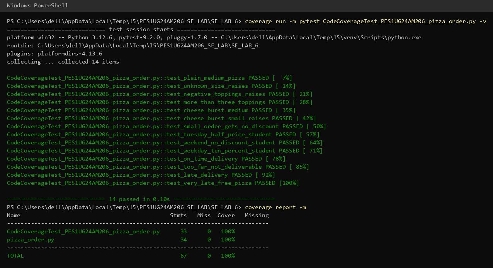
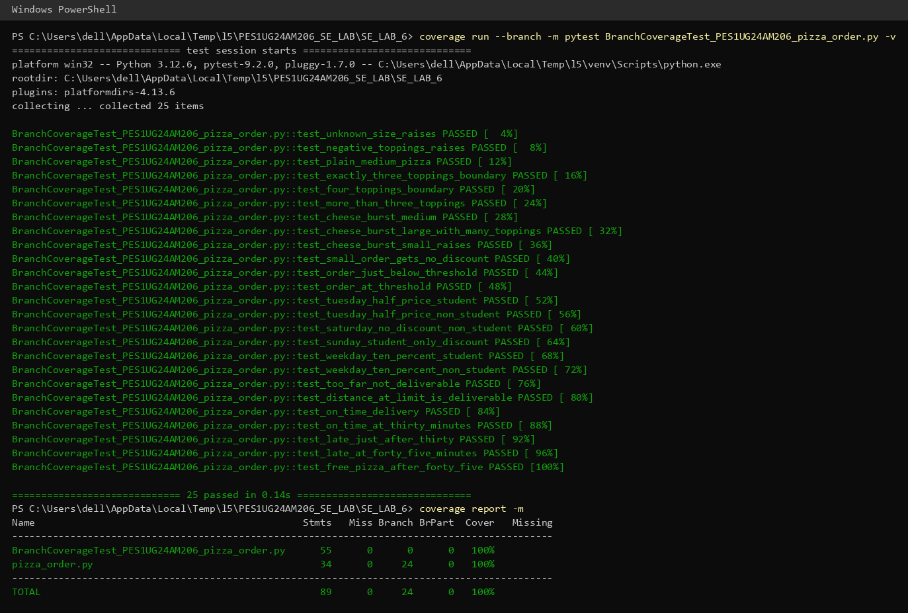

# Lab 6: Code and Branch Coverage - Pizza Order

**SRN:** PES1UG24AM206
**Source repo:** https://github.com/SETAPESU26/L6_L7_24_pizza_order (`Lab 6/`)
**Module under test:** `pizza_order.py` (`pizza_price`, `order_discount`, `delivery_status`)
**Tools:** Python 3.12.6, pytest 9.2.0, coverage.py

## Folder contents

| Path | Contents |
|------|----------|
| `pizza_order.py` | Application under test (unchanged) |
| `test_pizza_order.py` | Starter test file from the repo (2 tests) |
| `CodeCoverageTest_PES1UG24AM206_pizza_order.py` | 14 tests written for code (line) coverage |
| `BranchCoverageTest_PES1UG24AM206_pizza_order.py` | 25 tests written for branch coverage |
| `screenshots/code_coverage.png` | Terminal output: line coverage of the code coverage tests |
| `screenshots/code_coverage_branch_view.png` | Same tests measured with `--branch` (shows the missed branch) |
| `screenshots/branch_coverage.png` | Terminal output: branch coverage of the branch coverage tests |
| `coverage_output/*.txt` | Full text of every run, including the starter-test baseline |

## Results (`pizza_order.py`)

| Test file | Tests | Line coverage | Branch coverage | Missing |
|-----------|-------|---------------|-----------------|---------|
| `test_pizza_order.py` (starter) | 2 | 41% | 34% (6 partial branches) | lines 6, 8, 11, 15-17, 22-32, 37, 40-42 |
| `CodeCoverageTest_...py` | 14 | **100%** | 98% (1 partial branch) | branch `30->32` |
| `BranchCoverageTest_...py` | 25 | **100%** | **100%** (24/24 branches) | none |

All 14 and all 25 tests pass.

## Code coverage

Commands:
```bash
coverage run -m pytest CodeCoverageTest_PES1UG24AM206_pizza_order.py
coverage report -m
```

Each test targets lines the starter tests never reached: unknown size and negative toppings (`ValueError`), more than 3 toppings, cheese burst on medium and on small (error), orders under 300, Tuesday / weekend / weekday discounts, and the "not deliverable", "late" and "free pizza" delivery results. This executes every line, giving **100% line coverage**.

This is where line coverage and branch coverage differ. Measured with `--branch`, the same tests reach only **98%**. Every discount test used `is_student=True`, so the `False` side of `if is_student:` (jump from line 30 to 32) was never taken. Every line ran, but one decision outcome was never tested.



## Branch coverage

Commands:
```bash
coverage run --branch -m pytest BranchCoverageTest_PES1UG24AM206_pizza_order.py
coverage report -m
```

The branch tests make every `if`/`elif`/`else` go both ways and check the boundary values where each condition flips:

| Decision | Values tested |
|----------|---------------|
| `toppings > 3` | 3 (False), 4 (True) |
| `is_cheese_burst` / `size == "small"` | off; on with medium/large; on with small (raises) |
| `order_total < 300` | 299 (True), 300 (False) |
| `day == "tuesday"` / weekend / else | tuesday, saturday, sunday, wednesday, friday |
| `is_student` | True and False for each discount type |
| `distance_km > 10` | 10 (False), 15 (True) |
| `minutes_taken <= 30` / `<= 45` | 30, 31, 45, 46 |

Result: **24/24 branches, 100% branch coverage**.



## Observations

- The starter tests only covered the "happy path" (41% of lines), so most of the error handling and all of `order_discount` were untested.
- 100% line coverage did not mean everything was tested. The non-student discount path was never run, and a bug there would have gone unnoticed. Branch coverage exposed it.
- Boundary tests (3/4 toppings, 299/300 total, 30/31 and 45/46 minutes, 10 km) check that `<`, `<=` and `>` are the right operators, which neither metric checks on its own.

## Reproduce

```bash
pip install coverage pytest
coverage run -m pytest CodeCoverageTest_PES1UG24AM206_pizza_order.py
coverage report -m
coverage run --branch -m pytest BranchCoverageTest_PES1UG24AM206_pizza_order.py
coverage report -m
```
